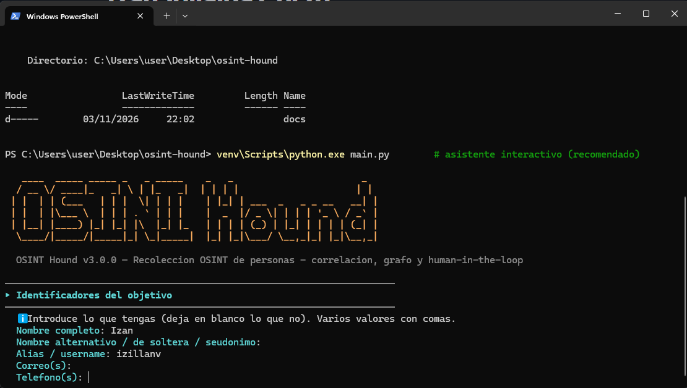
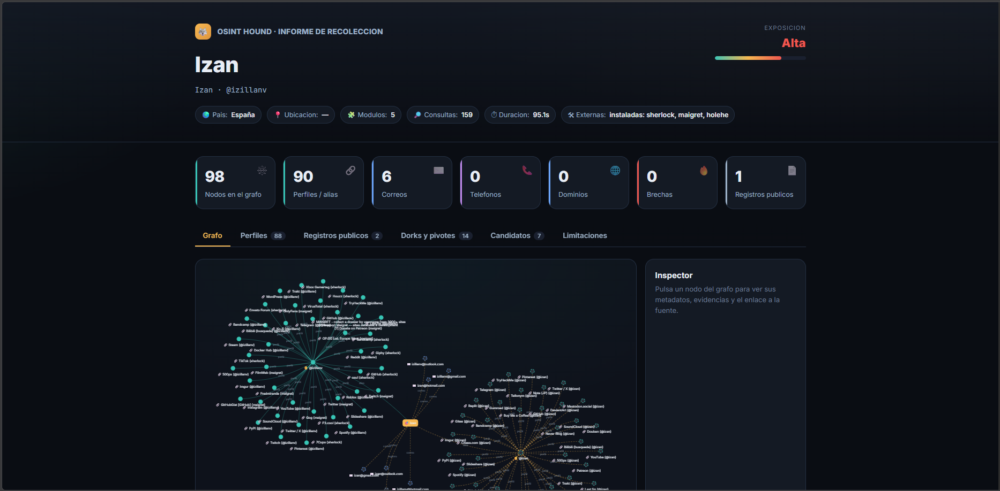
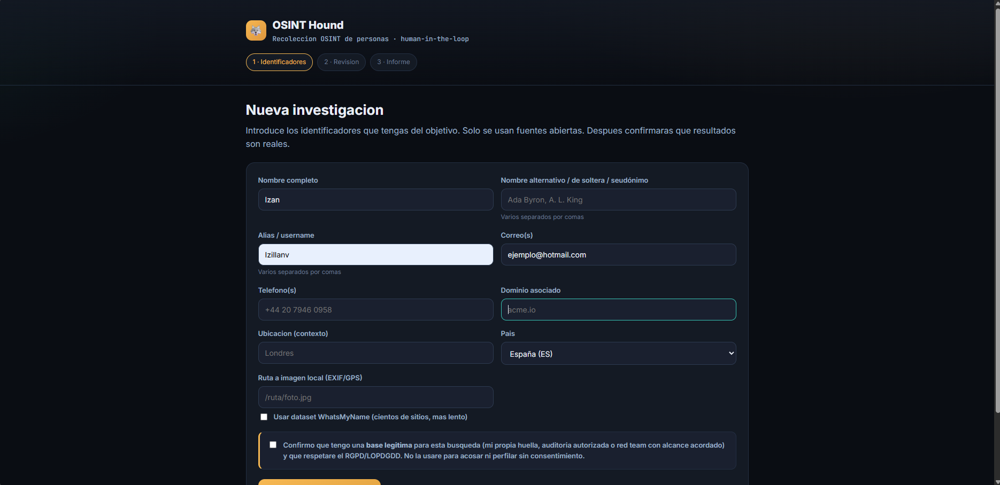

# 🐺 OSINT Hound

**Framework modular de recolección OSINT de personas**, con correlación de datos,
grafo de relaciones interactivo (en **árbol** o en red), interfaz **web** y
decisiones **human-in-the-loop** en todo el flujo.

> ⚖️ **Uso ético y legal.** Esta herramienta recopila **solo información de fuentes
> abiertas** (OSINT). Úsala con una base legítima: análisis de tu **propia** huella
> digital, auditorías de exposición **con autorización**, o red team con **alcance
> acordado**. No la uses para acosar, vigilar o perfilar a nadie sin consentimiento.
> Eres responsable del cumplimiento del **RGPD/LOPDGDD** y la legislación aplicable.

---

## ✨ Qué hace

A partir de **uno o varios identificadores** (nombre, alias, correo, teléfono o
dominio), OSINT Hound recolecta información de múltiples fuentes, **deja que el
analista confirme qué es real** (descartando homónimos y falsos positivos),
**correlaciona** las entidades entre sí y genera un **informe visual** con el grafo
de relaciones.

- 🌍 **Alcance mundial** — no solo España. Teléfonos de cualquier país (E.164),
  registros oficiales por país (BOE/BORME, Companies House, SEC, EUR-Lex…) y
  cientos de sitios sociales internacionales.
- 🧠 **Human-in-the-loop** — nada "ruidoso" se lanza sin tu confirmación: una
  puerta de consentimiento, la **selección de módulos**, la **revisión de
  candidatos** y la elección de pivotes son decisiones tuyas.
- 🕸️ **Grafo bonito** — vista en **árbol jerárquico** o en **red de fuerzas**,
  inspector de nodos, leyenda, física on/off y exportación a **PNG** y **JSON**
  (y a **Graphviz DOT** desde la CLI).
- 🖥️ **Interfaz web** — flujo guiado en 3 fases (descubrir → confirmar → informe).
- 🧩 **Modular y ampliable** — cada fuente es un módulo independiente; añadir una
  nueva es crear un fichero. Integra herramientas externas si están instaladas.
- 🔒 **Confirmado vs. POSIBLE** — lo verificado se distingue siempre de lo inferido
  (línea discontinua ámbar en el grafo y en el informe).

👉 **Ejemplo de ejecución** con datos ficticios: abre
[`reports/demo_report.html`](reports/demo_report.html) (o genéralo con `python demo.py`).

---

## 🔎 Fuentes y módulos

| Módulo | Entrada | Qué obtiene |
|---|---|---|
| **Huella pública** (`footprint`) | nombre / alias de nombre | Menciones del nombre (y nombres de soltera/seudónimos) en la web, clasificadas (oficial/gobierno, académico, medios, redes, documentos) |
| **Enumeración de usuarios** (`username_enum`) | alias | Comprobación del alias en ~80 sitios integrados (incluye redes **geográficas**: VK, Douban, Qiita, Naver…) **+ cientos** vía dataset de **WhatsMyName** (`--wmn`) |
| **Análisis de correo** (`email_recon`) | correo | **Gravatar** (nombre, foto y cuentas vinculadas), registros **MX** y clasificación del proveedor |
| **Brechas de datos** (`breach_check`) | correo | Filtraciones conocidas (**HIBP** con clave / **XposedOrNot** gratis). No muestra contraseñas |
| **Análisis telefónico** (`phone_check`) | teléfono | País, operador, tipo de línea, zona horaria y E.164 (**mundial**, sin red) |
| **Auditoría de dominio** (`domain_recon`) | dominio | **DNS** (A/MX/NS/TXT), **WHOIS**, **SPF/DMARC**, **subdominios** (crt.sh) + **Wayback Machine, urlscan, DNSDumpster** |
| **Registros oficiales** (`public_records`) | nombre | Accesos a **BOE, BORME, BDNS**, boletines autonómicos y equivalentes por país (Companies House, SEC, The Gazette, EUR-Lex…) |
| **Metadatos de imagen** (`image_recon`) | imagen | **EXIF/GPS** (cámara, fecha, mapa) + búsqueda inversa (Google/Yandex/TinEye), **FotoForensics** y geoestimación (**sin reconocimiento facial**) |
| **Google Dorks y pivotes** (`dorks`) | cualquiera | Dorks multi-motor y enlaces OSINT por categoría (Nombre/Alias/Correo/Teléfono): LinkedIn/directorios, IntelX→Yandex, EmailOSINT… |
| **Herramientas externas** (`external_tools`) | alias/correo/dominio | Integra **sherlock, maigret, holehe, theHarvester** si están instaladas |

### Correlación (extra)
El módulo de correlación deriva **alias y correos candidatos** a partir de datos
parciales (p. ej., del nombre → `adaloveking`, `ada.king@gmail.com`…) marcados como
**POSIBLE**, y une las entidades: perfiles que comparten alias, correo cuyo dominio
coincide con un dominio objetivo, brecha ligada a su correo, etc.

---

## 🧱 Requisitos previos

- **Python 3.9 o superior**.
- Paquetes de `requirements.txt` (`requests`, `phonenumbers`, `dnspython`,
  `python-whois`, `Pillow`, `Flask`). Todo funciona con estos.
- *(Opcional)* Herramientas externas vía **pipx**:
  ```bash
  pipx install sherlock-project
  pipx install maigret
  pipx install holehe
  pipx install theHarvester
  ```
- *(Opcional)* **ExifTool** para metadatos de imagen más completos (Pillow ya cubre
  EXIF/GPS básicos).
- *(Opcional)* Claves de API en un fichero `.env` (ver `.env.example`): `HIBP_API_KEY`,
  `HUNTER_API_KEY`. **Ninguna es obligatoria.**

---

## 🚀 Instalación

### Linux / macOS
```bash
git clone https://github.com/<tu-usuario>/osint-hound.git
cd osint-hound

python3 -m venv venv
source venv/bin/activate
pip install -r requirements.txt
```

### Windows (PowerShell)
```powershell
git clone https://github.com/<tu-usuario>/osint-hound.git
cd osint-hound

python -m venv venv
venv\Scripts\python.exe -m pip install -r requirements.txt
```
> En PowerShell, si `activate` da problemas por la *ExecutionPolicy*, puedes
> **saltarte la activación** y llamar al intérprete del venv directamente:
> `venv\Scripts\python.exe main.py`

---

## 🧭 Uso

### 1) Asistente interactivo (recomendado)
```bash
python main.py            # Windows: venv\Scripts\python.exe main.py
```
Te preguntará los identificadores y, durante la ejecución, confirmarás:
la **autorización**, los **módulos** a lanzar y qué **hallazgos** son del objetivo.

### 2) Línea de comandos (no interactivo)
```bash
# Persona en Reino Unido
python main.py -n "Ada Lovelace King" -l Londres --country GB

# Varios identificadores, modo automático (requiere declarar autorización)
python main.py -u johndoe -e john@acme.com -d acme.com --auto --yes --wmn

# Permitir herramientas externas en automático
python main.py -u johndoe --auto --yes --external

# Listados
python main.py --list-modules
python main.py --list-tools
```
Parámetros: `-n/--name`, `--aka` (nombre de soltera/seudónimo), `-u/--username`,
`-e/--email`, `-p/--phone`, `-d/--domain`, `-l/--location`, `--country`, `--image`,
`-o/--output`, `--slug`, `--auto`, `--yes`, `--external`, `--wmn`, `--open`, `--no-color`.

### 3) Interfaz web
```bash
python web/app.py
# Abre http://127.0.0.1:5000
```
Flujo de 3 fases: introduces los datos → el servidor **descubre candidatos** →
**confirmas** cuáles son del objetivo (human-in-the-loop) → se genera el informe
con el grafo embebido y botones de descarga.

### 4) Demo con datos ficticios (sin red)
```bash
python demo.py
# Genera reports/demo_report.html — ábrelo en el navegador
```

---

## 📊 El informe

El HTML generado (`reports/*.html`) es **autocontenido** (solo el grafo carga
vis-network desde CDN) e incluye:

- **Cabecera** con el objetivo, nivel de **exposición** y estadísticas.
- **Grafo interactivo** con conmutador **Árbol ⟷ Red**, física on/off, centrar,
  **exportar PNG** y **exportar JSON**.
- **Inspector** lateral: pulsa un nodo para ver metadatos, evidencia y la fuente.
- **Pestañas** por tipo de dato: Perfiles, Correos y brechas, Teléfono, Dominio,
  Registros públicos, Huella pública, Imagen, Dorks y pivotes, Candidatos.
- **Limitaciones y trazabilidad** (alcance OSINT, falsos positivos, homónimos,
  módulos ejecutados y nº de consultas).

Además se exportan:
- `reports/*.json` — **volcado completo** (metadatos + grafo + hallazgos), reutilizable.
- `reports/*.dot` — grafo en **Graphviz DOT**: `dot -Tpng reports/<archivo>.dot -o grafo.png`
  (o impórtalo en otras herramientas de grafos / Maltego).

---

## 🗂️ Arquitectura

```
osint-hound/
├── main.py                 # CLI (asistente + argparse)
├── demo.py                 # informe de ejemplo con datos ficticios
├── requirements.txt
├── .env.example            # claves de API (opcionales)
├── osinthound/
│   ├── config.py           # configuración central (HTTP, claves, paleta, países)
│   ├── console.py          # salida con color (segura en Windows)
│   ├── validators.py       # validación de entrada (no interrumpe la ejecución)
│   ├── hitl.py             # primitivas human-in-the-loop
│   ├── finding.py          # modelo de hallazgo
│   ├── entity.py           # grafo: nodos, aristas y export (dict/DOT)
│   ├── correlate.py        # candidatos derivados + construcción del grafo
│   ├── engine.py           # orquestación + revisión
│   ├── modules/            # 1 fuente OSINT por fichero (plugins)
│   │   ├── base.py         # BaseModule + Context + registro
│   │   ├── footprint.py  username_enum.py  email_recon.py  breach_check.py
│   │   ├── phone_check.py  domain_recon.py  public_records.py
│   │   ├── image_recon.py  dorks.py  external_tools.py
│   ├── report/             # generación del informe (HTML/JSON/DOT)
│   └── sites/sites.json    # catálogo de sitios (fallback offline)
└── web/                    # interfaz Flask (templates + static)
```

### Añadir una fuente nueva
1. Crea `osinthound/modules/mi_modulo.py` con una clase `@register` que herede de
   `BaseModule` e implemente `run(target, ctx)`.
2. Impórtala en `osinthound/modules/__init__.py`.
3. Listo: aparece sola en el selector de módulos, la CLI y la web. **No hay que
   tocar el motor** ni el informe.

---

## 🧩 Extras incluidos (fuera de los mínimos)

- Correlación de entidades y **perfilado por alias** compartido.
- **Grafo en árbol/red** con inspector y exportación PNG/JSON/**Graphviz DOT**.
- **Interfaz web** completa con revisión human-in-the-loop.
- **Datos derivados** (alias/correos candidatos) marcados como POSIBLE.
- **Trazabilidad**: registro de consultas realizadas (útil para auditoría).
- **Validación robusta** que descarta entradas inválidas sin romper la ejecución.

---

## 📝 Técnicas de los apuntes
El fichero [`APUNTES.md`](APUNTES.md) traza **cada técnica de OSINT de personas**
de los apuntes de clase hasta el punto exacto del código donde está implementada,
y explica qué se deja fuera a propósito (reconocimiento facial, volcados de
credenciales) y por qué.

## 📜 Licencia
MIT — ver [`LICENSE`](LICENSE). Incluye el aviso de uso ético y legal.

## Capturas de ejemplo




